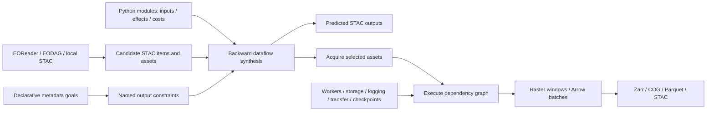

# AutoSTACGIS Python

AutoSTACGIS discovers geospatial data described by STAC, synthesizes a processing workflow from output goals, and executes it using native raster windows or Arrow batches. It supports remote inventories, local imagery, raw photographs, vector datasets, and point clouds through discovery and inspection plugins.

The [AutoSTACGIS specification](https://github.com/autostacgis/autostacgis) defines the v1 contracts. This repository contains the Python implementation and pinned EODAG and EOReader forks in `external/`.



Install with Python 3.12 or newer:

```sh
pip install -e '.[dev]' -e '../autostacgis-plugins[dev]'
pip install -e external/eodag -e external/eoreader
```

Use the conda environment in `environment.yml` for GDAL-backed operations. Optional extras in `autostacgis-plugins` include `atmosphere`, `spectralmatch`, `registration`, `cloud`, `pointcloud`, and `distributed`. Py6S also requires the 6S executable; cloud inference requires the model assets supplied by OmniCloudMask.

The standard way to run a workflow is a single self-contained `config.yaml` (or
`config.json`) containing `catalog` and `request` sections. Keep the settings you
need to change in that file; omitted settings retain their defaults.

```python
from autostacgis import Application

app = Application.from_file('examples/pansharpen/config.yaml')
print(app.plan().to_dict())
with app.run() as result:
    for record in result:
        print(record.item)
```

A runnable local example:

```sh
python examples/pansharpen/create_demo.py
autostacgis validate examples/pansharpen/config.yaml
autostacgis plan examples/pansharpen/config.yaml
autostacgis run examples/pansharpen/config.yaml
```

Each processing function carries an inspectable contract. Inputs and generated outputs are the same `Record` type; each identifies a selected STAC asset and carries a separate native payload handle. Named outputs can feed further modules or branch to several consumers. Collections bind actual members and wait for every selected member to satisfy their input requirements.

The `backward_chain` solver accepts declarative `output`, `for_each`, `all_of`, and `any_of` goals. Reusing an output name combines constraints on that same result. `for_each` selects the initial inventory and requires a corresponding output for every selected member. Spatial coverage is checked against geometry, with unknown footprints remaining unknown. The `metadata-value` adapter supports JSONata values and spatial predicates over bbox, polygon, or custom geometry metadata.

The solver builds dataflow graphs backward from required output states, memoizes subproblems, and prunes unreachable requirements. Installed plugins are selected explicitly in YAML through the `autostacgis.plugins` entry-point namespace. Competing producers of a required state raise `AmbiguousProducer`: select one algorithm, such as Markov, weighted, or Voronoi seamlines.

JSONata and Python costs read predicted metadata. The solver uses cost previews to prefer operation orderings, then evaluates costs on the selected input versions. Shared operations are charged once. It returns a feasible `synthesized` plan, not a global optimality claim. Step, subproblem, binding, and time limits raise `SearchLimit`; exhausted derivations raise `NoPlan`.

Runtime settings control shared workers, native thread budgets, tile sizes, and scratch storage. Plugins may request seekable files when their native algorithms need them; otherwise, replayable raster windows and Arrow batches pass between operations. A lazy output remains usable while its `RunResult` is open. Output publication materializes durable data through a format encoder and destination. The executor rechecks input requirements, costs, output contracts, and final goals.

- [Examples](examples/README.md)
- [Data flow, transfer, and checkpoints](docs/data-flow.md)
- [Plugin authoring](docs/plugins.md)
- [STAC and discovery](docs/stac.md)
- [Dependencies and runtime services](docs/dependencies.md)
- [Custom processing plugin example](https://github.com/autostacgis/autostacgis-plugins/blob/main/examples/scale_plugin.py)
- [Combined mosaic goals](examples/mosaic/config.yaml)
- [Explicit mosaic steps](examples/mosaic-explicit/config.yaml)

Run `pytest`, `ruff check autostacgis tests tools examples`, and `python tools/check_spec.py` to verify the implementation. `tools/export_examples.py` regenerates the small, self-contained workflow examples.

Select a workflow's plugins and their dependencies:

```yaml
version: 1.0.0
plugins:
  - use: stac-resolver
    settings: {search_glob: "data/**/*.tif"}
  - use: pansharpen
  - use: executor
  - use: storage
  - use: events
  - use: geotiff
  - use: stac-json
```

See [the WorldView configuration](examples/worldview/config.yaml) for the complete processing selection. Py6S requires an elevation-summary input: `sample_dem` computes the mean of valid DEM pixels inside each scene footprint, in meters, and Py6S converts it to kilometers. No sea-level fallback is applied. Reference registration imports Coregix; footprint cleanup imports the same SpectralMatch implementation used by VHRHarmonize. GeoTIFF/COG writers embed the complete Item in the `STAC` metadata tag and map band names, units, scales, offsets, and acquisition time to native headers.

Run configurations combine `catalog` (available plugins) and `request` (goals and
overrides) in one file. The solver seeks outputs satisfying `request.goal`, while
respecting plugin contracts and explicit step constraints. The request may declare
named `steps` with `plugin`,
`settings` or `param:name` overrides and explicit `{auto: true}` solver gaps.
With no steps, synthesis remains automatic; without gaps, steps must satisfy all
prerequisites and final goals. Native links use `result:step:port`; parameters can
select Item metadata with `result:step:port#/JSON/pointer`. Explicit output
locations use `outputs: {result: 'path:./saved.tif'}` and become asset hrefs.
See [practical workflows](examples/README.md), the comprehensive
[configuration references](https://github.com/autostacgis/autostacgis/tree/main/examples), and the
[configuration specification](https://github.com/autostacgis/autostacgis/blob/main/specification.md#run-configuration).


Standard plugins are distributed separately in
[autostacgis-plugins](https://github.com/autostacgis/autostacgis-plugins).
From sibling checkouts, install both with
`python -m pip install -e '.[dev]' -e '../autostacgis-plugins[dev]'`.
Integration extras now belong to `autostacgis-plugins`; for example install
`../autostacgis-plugins[spectralmatch,registration]` for those processing libraries.
Each plugin declares one `CAPABILITY` and one `IMPLEMENTATION`. See the
[before-and-after inventory](https://github.com/autostacgis/autostacgis-plugins/blob/main/docs/plugin-migration.md)
for split registration names and import changes.

Goal presets now live in configuration. Select one solver with `solver: {plugin: backward_chain, settings: {timeout: 120}}`. Generic goal adapters must declare that solver as a named dependency and expose parameter schemas; see [solver contracts](https://github.com/autostacgis/autostacgis-plugins/blob/main/docs/solvers.md).
